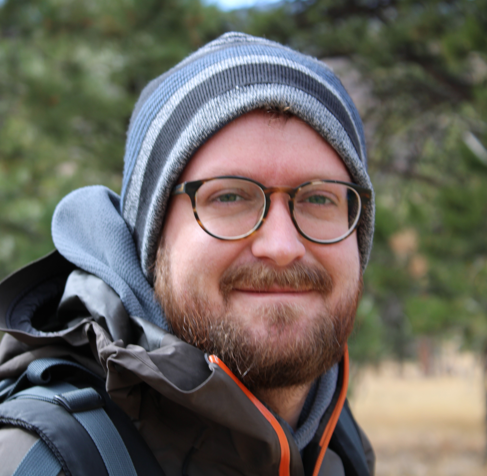

I’m an [Assistant Professor of Biology](https://bio.as.virginia.edu/people/nicholas-landry) at the University of Virginia (as well as a courtesy faculty member in the [School of Data Science](https://datascience.virginia.edu/people/nicholas-landry)) and I lead an [interdisciplinary lab](https://landry-lab.github.io/) studying how networks and groups (higher-order interactions) affect the spread of diseases, information, and opinions. I use tools from network science, mathematical modeling, Bayesian inference, and open-source software.

My [portfolio](/portfolio/) is a collection of some projects that I’ve worked on personally, professionally, and academically. For more about me, see my [bio](/pages/about.qmd), [CV](/assets/docs/CV.pdf), or list of [publications](/pages/publications.qmd). You can also take a look at my [blog](/blog/).

::: {.column-page-inset .text-center}
```{=html}
<a class="btn btn-outline-dark", href="mailto:nicholas.landry@virginia.edu" target="_blank" rel="noopener noreferrer">
    <i class="ai bi-envelope" role='img' aria-label='Email'></i> Email
</a>
<a class="btn btn-outline-dark", href="https://scholar.google.com/citations?user=7xLeZqMAAAAJ" target="_blank" rel="noopener noreferrer">
    <i class="ai ai-google-scholar" role='img' aria-label='Google Scholar'></i> Scholar
</a>
<a class="btn btn-outline-dark", href="https://bsky.app/profile/nwlandry.bsky.social" target="_blank" rel="noopener noreferrer">
    <i class="fa-brands fa-bluesky" role='img' aria-label='Bluesky'></i> Bluesky
</a>
<a class="btn btn-outline-dark", href="https://github.com/nwlandry" target="_blank" rel="noopener noreferrer">
    <i class="bi bi-github" role='img' aria-label='Github'></i> Github
</a>
<a class="btn btn-outline-dark", href="https://orcid.org/0000-0003-1270-4980" target="_blank" rel="noopener noreferrer">
    <i class="ai ai-orcid" role='img' aria-label='ORCID'></i> ORCID
</a>
<a class="btn btn-outline-dark", href="https://www.linkedin.com/in/landrynicholas/" target="_blank" rel="noopener noreferrer">
    <i class="bi bi-linkedin" role='img' aria-label='LinkedIn'></i> LinkedIn
</a>
<br>
<br>
```
:::

## Research Interests
* The structure and dynamics of complex systems (particularly those involving higher-order interactions)
* Contagion spread (disease, opinions, etc.)
* Inference of network structure
* Open software

## Recent News

* **November 2026**: My paper titled [Finding Common Ground: Graded Communal Knowledge in Bluesky Starter Packs](https://arxiv.org/abs/2609.19549) in collaboration with Sagar Kumar, Lawrence Swaminathan Xavier Prince, Julia Mendelsohn, and Brooke Foucault Welles has been accepted at [ICWSM 2027](https://www.icwsm.org/2027/index.html)!
* **November 2026**: I gave a talk at [ASA SLDS 2026](https://asa-slds.github.io/slds2026/) talking about "Cartographic Characterization of Complex Contagions".
* **November 2026**: XGI [v1.0](https://github.com/xgi-org/xgi/releases#release-v1.0.0) has been released! This is the first stable release and there will be no breaking changes in the future!
* **September 2026**: New preprint posted! [Finding Common Ground: Graded Communal Knowledge in Bluesky Starter Packs](https://arxiv.org/abs/2609.19549) in collaboration with Sagar Kumar, Lawrence Swaminathan Xavier Prince, Julia Mendelsohn, and Brooke Foucault Welles is posted on ArXiv! This paper finds evidence for common ground on Bluesky, the social media platform.
* **September 2026**: New paper out! [NotD: The network of the day](https://doi.org/10.2478/connections-2026-0005) in collaboration with Abhay Gupta and Jessica Taggart is now published in Connections! It introduces an accessible, low-effort classroom activity for network science classes.
* **July 2026**: New preprint out! [Emergent contagion complexity: Disentangling mechanistic complexity from correlated heterogeneity](https://arxiv.org/abs/2607.25139) with [Katerina Tang](https://kbtang28.github.io/), [Daniel Kaiser](https://kaiser-dan.github.io/), [William Thompson](https://www.willhwthompson.com/), [Jean-Gabriel Young](https://jgyoung.ca/), and [Laurent Hébert-Dufresne](https://laurenthebertdufresne.github.io/).
* **July 2026**: I gave a talk at [IC2S2 2026](https://ic2s2-2026.org) in Burlington on the [A Blue Start](https://doi.org/10.1038/s41597-026-06920-1) dataset!
* **June 2026**: I was at [NetSci 2026](https://www.netsci2026.com) in Boston! I gave a talk titled "Cartographic Characterization of Complex Contagions".
* **May 2026**: I was awarded a [SPARC Grant](https://research.as.virginia.edu/seed-funding) for the project "Understanding information diffusion on social media through the lens of ideological groups."
* **May 2026**: Paper accepted! "NotD: The network of the day" in collaboration with Abhay Gupta and Jessica Taggart is accepted at Connections!
* **May 2026**: I was awarded a [Ralph E. Powe Junior Faculty Enhancement Award](https://www.orau.org/news/releases/2026/orau-awards-180k-in-research-grants-to-36-junior-faculty.html) for the project "Investigating how groups shape the diffusion of content on social media platforms."
* **May 2026**: New preprint out! [The nestedness of higher-order networks](https://arxiv.org/abs/2605.18420) in collaboration with Tim LaRock, Yanting Zhang, Jean-Gabriel Young, Nicole Eikmeier, and Renaud Lambiotte. We survey and unify different measures of higher-order inclusion structure.
* **May 2026**: New preprint out! [The interplay of network structure and correlated infectious traits in epidemic models](https://arxiv.org/abs/2605.12773) with my grad student Abhay Gupta. Check it out!
* **May 2026**: I gave a talk at the [Department of Genome Sciences](https://med.virginia.edu/genome-sciences/) annual retreat.
* **April 2026**: ["A Blue Start: A large-scale pairwise and higher-order social network dataset"](https://doi.org/10.1038/s41597-026-06920-1) is now published in Scientific Data!
* **March 2026**: New preprint posted! [Higher-order interactions at scientific conferences influence team formation](https://arxiv.org/abs/2603.02571) in collaboration with [Emma Zajdela](https://sites.northwestern.edu/emmazajdela/).
* **December 2025**: New article published! [HIF: The hypergraph interchange format for higher-order networks](https://doi.org/10.1017/nws.2025.10018) out in Network Science!

[Older news](news.qmd)